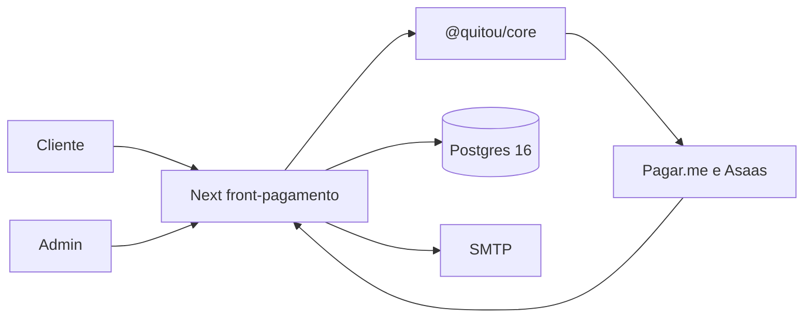

# 05 — Architecture

> **Gate:** `status: approved`. O manager autorizou o início da implementação da v1 em 2026-11-09. Em 2026-11-10 o host de produção ficou definido: um servidor só, Next e Postgres na rede interna, nginx na porta pública.

## Objective

Descreve como o Quitou está montado hoje e qual é o alvo pedido para o banco. Não detalha cada coluna. Isso fica em `06_database.md`. Não lista cada rota. Isso fica em `07_api_contracts.md`.

## System context

Estado atual. O browser não fala com o banco. A interface importa `@quitou/core/pricing`. O servidor importa o barrel e `@quitou/core/product-webhook`.



O que ainda não foi executado é só a mudança de host: o mesmo desenho, com o Postgres no VPS. O corte está em `08_environments.md`.

**Repository layout (high level):**

```txt
/
  front-pagamento/     # Next.js: UI, rotas, sessão e pool Postgres
  packages/core/       # preço, cupom, gateway e efeito de webhook
  docs/                # fase Meridian e guias anteriores
  .agent/              # kit Meridian
  .github/workflows/   # CI
```

O guia `docs/guides/quitou/02-arquitetura.md` ainda diz que o core mora em `../pagamento/`. No monorepo o caminho é `packages/core`.

## Layers and boundaries

| Layer | Responsibility | Paths | Depends on |
| ----- | -------------- | ----- | ---------- |
| UI | página, formulário, hook | `front-pagamento/src/app`, `src/components`, `src/hooks` | API, sessão e `@quitou/core/pricing`. Não o banco |
| API | guard, HTTP, adaptação | `front-pagamento/src/app/api` | core, repositório, env |
| Domain | checkout, webhook, validação | `packages/core/src` | contrato de persistência injetado |
| Infrastructure | pool Postgres | `front-pagamento/src/lib/db` | `DATABASE_URL` |
| Data | schema `payments` | `front-pagamento/db/migrations` | Postgres 16 |

## Major components

| Component | Purpose | Tech | Owner module |
| --------- | ------- | ---- | ------------ |
| Checkout | escolher preço, cupom, pagar | React, rotas de API | `front-pagamento` |
| Admin | catálogo e operação | React, rotas `/api/admin` | `front-pagamento` |
| Auth | código por e-mail e cookie `httpOnly` | Postgres `access_codes` e `sessions` | `src/lib/auth`, `proxy.ts` |
| Gateways | criar cobrança e tratar webhook | `@quitou/core` | `packages/core/src/routes` |
| Persistência | pedidos, preços, perfis | SQL no servidor | `front-pagamento/db/migrations` |
| E-mail | código e aviso de pedido | SMTP | env, `src/lib/email-helpers.ts` |

## Integration points

| System | Direction | Protocol | Auth | Failure mode |
| ------ | --------- | -------- | ---- | ------------ |
| Pagar.me | outbound na criação, inbound no webhook | HTTPS JSON | chave e segredo de webhook | checkout falha. Webhook inválido não grava |
| Asaas | outbound e inbound | HTTPS JSON | API key e segredo | igual |
| Postgres | o processo Next | SQL na rede Docker ou em `127.0.0.1:5435` | usuário e senha do `DATABASE_URL` | tela e API falham juntas se o banco cair |
| SMTP | outbound | SMTP | usuário e senha | pedido pode existir sem e-mail. Lacuna de compensação não lida aqui |
| CEP | outbound | HTTP | não documentado nesta passagem | endereço manual se a rota falhar |
| Nginx do host | borda TLS | HTTPS para o Next em HTTP interno | o proxy reescreve `X-Forwarded-For` | sem `TRUSTED_PROXY=1` o rate limit não vê o IP do cliente |

## Key flows

### Flow 1 — entrar com código

1. A pessoa informa o e-mail no login ou no checkout.
2. `POST /api/auth/access-code` grava o HMAC do código e envia o e-mail. Não altera um perfil que já existe.
3. `POST /api/auth/access-code/verify` confere o código, grava `payments.sessions` e seta o cookie `httpOnly`.
4. O proxy só exige a presença do cookie em `/admin` e `/profile`. A rota chama `requireAdmin` ou a sessão no servidor.

### Flow 2 — pagar

1. A página de checkout carrega o preço por API.
2. O browser chama a rota de checkout do gateway.
3. O core valida o corpo, grava pedido e pagamento no schema `payments` com o cliente admin, e chama o gateway.
4. O cliente acompanha status por polling de `GET /api/payments/[id]/status`, só do pagamento da própria sessão.
5. O webhook do gateway atualiza status, estoque e reembolso.

## Architecture detail files

| File | Topic | Status |
| ---- | ----- | ------ |
| `docs/architecture/` | ainda vazio. Detalhe só se `05` precisar fatiar | planned |
| `docs/guides/quitou/02-arquitetura.md` | narrativa anterior | legado, não é o gate |

## Cross-cutting concerns

| Concern | Approach | Doc ref |
| ------- | -------- | ------- |
| Auth | código por e-mail, cookie `httpOnly`, 14 dias | `02_security` |
| Logging | `src/lib/logger`. E-mail não entra no log de pedido de código | `02_security` |
| Feature flags | não há sistema de flag no código lido | — |
| Rate limit | memória por instância em `proxy.ts` | `02_security` |

## Mode B — as-is vs target

| Area | Current (evidence) | Target (if migrating) |
| ---- | ------------------ | --------------------- |
| Banco | Postgres 16, schema `payments`, sem RLS. Autorização nas rotas | o mesmo, no VPS, quando o corte acontecer |
| Acesso a dados | SQL só no servidor. Browser chama rota | igual |
| Sessão | código por e-mail e cookie `httpOnly` | igual |
| Tempo real | polling de `GET /api/payments/[id]/status` | igual |
| Host | padrão: um servidor. Nginx público, Next e Postgres na rede `quitou-db`. No Mac o Postgres fica em `127.0.0.1:5435` | o mesmo padrão no VPS. O corte de dados ainda é o passo de `08` |
| Identidade | `profiles.id` é o id da aplicação | igual |

## Gaps / open questions

| # | Gap | Blocks backlog |
| - | --- | -------------- |
| 1 | Região do VPS, domínio público e a cópia dos dados | yes para o go-live, não para o código |

## Gate

Só humano define `status: approved`. Rodar `/architecture` antes da aprovação. Sem isso, não criar épico nem user story.
