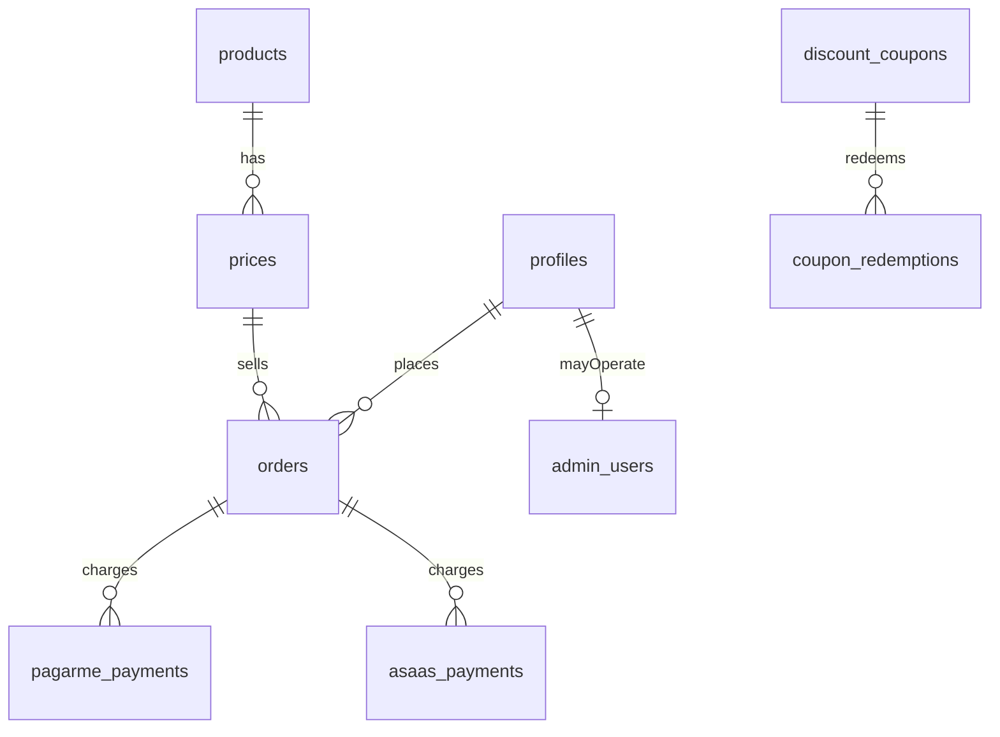

# 06 — Database

## Persistence model

| Attribute | Value |
| --------- | ----- |
| **Primary store** | PostgreSQL 16, schema `payments` |
| **ORM / client** | `pg`. Tipos em `front-pagamento/db/database.types.ts` |
| **Connection config** | `DATABASE_URL` só no servidor. Não há chave anônima nem URL de banco no bundle |
| **Multi-tenant** | não. Posse por `user_id` ou `profiles.id` |

As migrações aplicadas são `front-pagamento/db/migrations/`. Os SQL em `front-pagamento/supabase/migrations/` são histórico e não entram no boot.

## Schema overview

### Entity list

| Entity / table | Purpose | Owner service | PII? |
| -------------- | ------- | ------------- | ---- |
| `payments.products` | catálogo | admin | não. Pode ter URL de webhook |
| `payments.prices` | preço vendável | admin | não |
| `payments.price_promo_tiers` | faixa promocional | admin | não |
| `payments.price_addon_offers` | add-on entre preços | admin | não |
| `payments.price_upgrade_paths` | upgrade no mesmo produto | admin | não |
| `payments.discount_coupons` | cupom | admin | não |
| `payments.discount_coupon_products` | cupom por produto | admin | não |
| `payments.discount_coupon_prices` | cupom por preço | admin | não |
| `payments.coupon_redemptions` | uso de cupom | checkout | pode ligar a usuário |
| `payments.profiles` | cliente | checkout e perfil | sim |
| `payments.admin_users` | quem opera o painel | admin | e-mail operacional |
| `payments.orders` | pedido | checkout | liga ao perfil |
| `payments.pagarme_payments` | cobrança Pagar.me | checkout e webhook | identificador de pagamento |
| `payments.asaas_payments` | cobrança Asaas | checkout e webhook | identificador de pagamento |
| `payments.subscriptions` | assinatura | admin | liga ao usuário |
| `payments.webhook_events` | dedup e histórico de webhook | webhook | payload pode ter PII |
| `payments.email_logs` | e-mail enviado | admin | e-mail |
| `payments.platform_settings` | ajuste da plataforma | admin | não confirmado campo a campo |

`payments.profiles.id` referencia `auth.users(id)`. O usuário de login não é uma tabela do schema `payments`.

Política de reembolso aparece como JSON validado por `payments.validate_refund_policy`, não como tabela própria nesta leitura.

### Relationships

Não há schema `auth`. O usuário da aplicação é `payments.profiles`. Código e sessão ficam em `payments.access_codes` e `payments.sessions`. Ação privilegiada fica em `payments.admin_audit_events`.

## Migrations

| Rule | Value |
| ---- | ----- |
| Tool | SQL aplicado no Postgres. Sem `db reset` |
| Folder | `front-pagamento/db/migrations/` |
| Naming | legado `001_` … `019_` e também `YYYYMMDDHHMMSS_descricao.sql`. Regra do time para arquivo novo: data nesse formato |
| Apply in CI | não. O workflow não aplica migração |
| Rollback policy | sem down automático. Nova migração desfaz. Proibido `supabase db reset` e qualquer reset de banco |

Cópia em `packages/core/templates/migrations/` repete parte do schema. Não é o diretório aplicado pelo app. Tratar como template até alguém provar que o publish do pacote usa esses arquivos.

## Data access rules

| Layer | May write DB | May read DB |
| ----- | ------------ | ----------- |
| API handlers | sim, via repositório ou cliente admin | sim |
| Domain (`packages/core`) | sim, quando o handler injeta o cliente SQL | sim |
| UI | não | não |
| Scripts | geração de tipo e teste de banco | local |

## Indexes and performance

| Table | Index | Reason |
| ----- | ----- | ------ |
| orders | índice por usuário e data em `20250312180300_orders_user_created_at_index.sql` | lista de pedidos |
| asaas_payments | dedup em `20260319005725_asaas_payments_dedup_idx.sql` | webhook repetido |
| webhook_events | provider + event id em `20250312180200_webhook_events_provider_event_id.sql` | idempotência |

Lista incompleta de propósito. O schema real é a sequência de migrações, não esta tabela.

## Backup and restore

| Environment | Method | Frequency | RTO / RPO |
| ----------- | ------ | --------- | --------- |
| local | `deploy/postgres/backup.sh` com `pg_dump -Fc`, sete cópias no host | manual até o VPS | o arquivo dump |
| production | o mesmo script, cron diário, pasta fora do volume | diário, no corte | o arquivo dump |

O comando e o agendamento estão em `docs/08_environments.md`. A senha não entra no script.

## Security

- Encryption at rest: a do projeto Supabase. Não configurada neste repo.
- Row-level security: ligada nas tabelas de `payments`, com `auth.uid()` e `auth.role()`. Papéis `anon`, `authenticated`, `service_role`.
- Funções de integridade que o alvo deve manter sem `auth.*`: estoque (`sync_stock_sold_from_orders`, `recalc_stock_for_price`), upgrade no mesmo produto, reembolso (`apply_refund_to_order`, `validate_refund_policy`), `prevent_payment_delete`, `update_updated_at_column`.
- Funções de autorização que não devem ir para o Postgres novo: `is_admin_user`, `is_super_admin`, `get_current_admin`, `get_current_profile`, `handle_new_user`.
- Ver `02_security` § Data classification.

## Gaps / open questions

| # | Gap | Evidence needed |
| - | --- | --------------- |
| 1 | Retenção de `webhook_events` e `email_logs` | decisão do manager |
| 2 | Quem chama `cleanup_expired_payments` | busca de cron ou chamada no código, no `/architecture` |
| 3 | Cliente SQL e pasta da migração nova | escolha na história, depois do gate |
| 4 | `packages/core/templates/migrations` está sincronizado com `front-pagamento/supabase/migrations`? | diff dedicado. Não foi feito arquivo a arquivo nesta init |

## Gate

Humano aprova quando o schema descrito bater com o que está em produção. Citar as migrações, não um diagrama solto.
