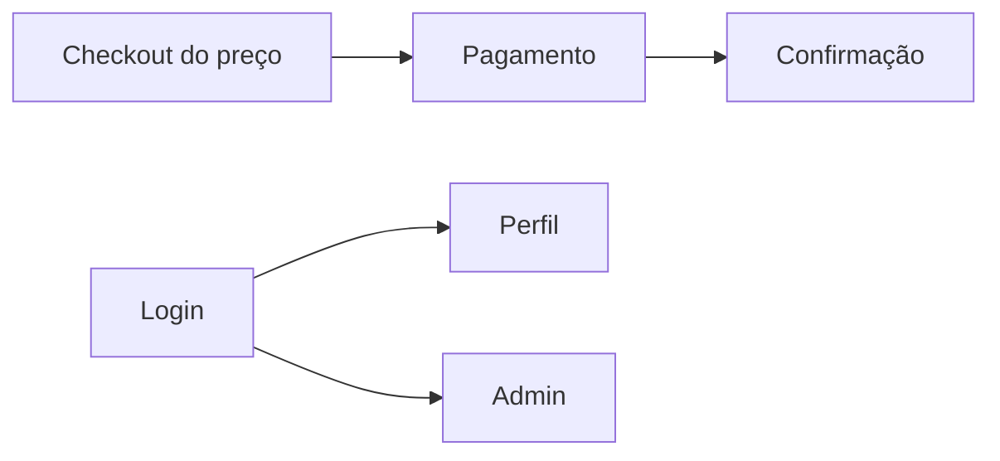

# 09 — Design system

## Overview

Rascunho de init. Completar com `/design-pass bootstrap`, `/design-flow` e `/design-theme` antes de tratar como contrato visual.

- **Surfaces:** web. Checkout, login, perfil, admin e página inicial.
- **Primary UI stack:** `ts-shadcn`. Tailwind v4, Radix, `class-variance-authority`, `lucide-react`, `sonner`, `next-themes`.
- **Mood:** ferramenta de pagamento e operação. Os guias visuais antigos estão em `docs/guides/guia-design/`.

## Colors

Tokens semânticos em `front-pagamento/src/app/globals.css`. Não copiar hex para feature.

| Token | Role | Theme key / CSS var |
| ----- | ---- | ------------------- |
| primary | ação principal | `--primary` |
| background | fundo da página | `--background` |
| foreground | texto | `--foreground` |
| muted | texto secundário | `--muted` |
| destructive | ação perigosa | `--destructive` |
| border | divisória | `--border` |
| success, warning, info | estado | `--success`, `--warning`, `--info` |

## Theme modes

| Mode | When it applies | Token set / file |
| ---- | --------------- | ---------------- |
| light e dark | classe `.dark` e `next-themes` | `globals.css`, variante `@custom-variant dark` |

Mesmos papéis semânticos nos dois modos. Ajuste fino fica no `/design-theme`.

## Typography

Fonte sans e mono apontam para Geist em `globals.css` (`--font-geist-sans`, `--font-geist-mono`). Escala de título não foi medida nesta init. O guia `docs/guides/guia-design/03-tipografia.md` é a referência antiga até o `/design-theme`.

| Role | Use | Size / weight / line-height | Stack key |
| ---- | --- | --------------------------- | --------- |
| h1 | título da tela | a definir no `/design-theme` | sans |
| h2 | seção | a definir | sans |
| body | texto | a definir | sans |
| label | campo | a definir | sans |
| caption | meta | a definir | sans |
| code | id e valor técnico | a definir | mono |

## Layout

- **Spacing scale:** escala padrão do Tailwind, guia `04-espacamento-composicao.md`.
- **Container max-width:** não medido nesta init.
- **Grid:** páginas de admin e checkout. Ver guia de layout.

## Elevation and depth

Sombras dos componentes shadcn. Não há escala própria documentada além do guia de design.

## Shapes

- **Border radius:** tokens do tema em `globals.css` (`--radius` e derivados, se presentes no restante do arquivo). Confirmar no `/design-theme`.

## Components

- **Primitives (read-only):** `front-pagamento/src/components/ui/`. Não editar primitivo para resolver uma tela.
- **Composed templates:** `front-pagamento/src/components/checkout/`, `components/payment/`, `components/auth/`, telas em `src/app/admin/`.
- **Composition:** o guia pede props de conteúdo. Vários fluxos usam arquivo `content.ts`.

### Inventory (composed)

| Template | Purpose | Showcase route |
| -------- | ------- | -------------- |
| checkout | compra | não há `/design` |
| login | código por e-mail | não há showcase |
| admin tables | operação | não há showcase |

Showcase real só via `/design-showcase` e história com gate. Não criar rota agora.

## Do's and don'ts

- Usar token semântico e componente de `components/ui`.
- Citar este doc no plano de história visual quando estiver aprovado.
- Não editar primitivo shadcn para um caso de checkout.
- Não hardcodar hex na feature.
- Não deixar conteúdo vazar no eixo horizontal.

## Responsive behavior

| Breakpoint | Width | Notes |
| ---------- | ----- | ----- |
| mobile | 0–639px | base, sem prefixo |
| sm | 640px+ | Tailwind |
| md / tablet | 768px+ | Tailwind |
| lg / desktop | 1024px+ | Tailwind |
| xl | 1280px+ | Tailwind |

Fonte: `docs/guides/guia-design/05-responsividade-breakpoints.md`. O que empilha em cada tela fica para `/design-flow`.

## Screen flows

| Flow | Surfaces | Entry | Empty | Error | Exit |
| ---- | -------- | ----- | ----- | ----- | ---- |
| Comprar | checkout | `/checkout/[priceId]` | preço inexistente | gateway ou validação | confirmação |
| Entrar | login | `/login` | — | código inválido | checkout, perfil ou admin |
| Operar | admin | `/admin` | lista vazia | 403 | mesma área |

## Accessibility baseline

- Foco visível em controle interativo.
- Contraste de texto no mínimo WCAG AA. Não auditado nesta init.
- Alvo de toque 44×44 px no mobile. Não medido.
- Campo com rótulo visível e erro em texto.

## Showcase catalog

| Route | Contents | Status |
| ----- | -------- | ------ |
| `/design` | visão e navegação | planned |
| `/design/tokens` | cor, tipo, espaço | planned |
| `/design/components` | composição e estado | planned |

## Gate

Humano define `status: approved` antes de história Must com aceite visual. Este rascunho não libera isso.
